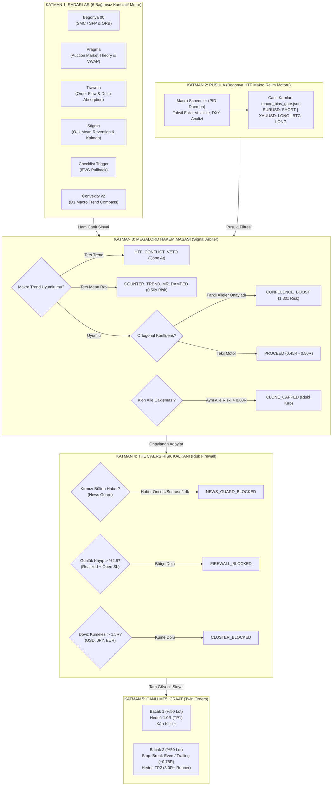

# 👑 MEGALORD META-ALLOCATOR & MULTI-STRATEGY ORCHESTRATOR

[](https://www.python.org/downloads/)
[](https://www.metatrader5.com/)
[](https://the5ers.com/)
[](https://opensource.org/licenses/MIT)

> **Megalord**, kurumsal fon (Prop-Firm / The 5%ers) değerlendirme hesapları için geliştirilmiş; 6 bağımsız niceliksel (quantitative) ticaret motorunu, yüksek zaman dilimli makro rejim pusulasını, ortogonal sinyal hakemini ve katı risk duvarını tek bir çatı altında yöneten **7/24 Otonom Portföy Meta-Orkestratörüdür**.

---

## 📌 İçindekiler
1. [Mimarinin Temel Felsefesi](#-mimarinin-temel-felsefesi)
2. [Sistem Mimarisi (End-to-End Workflow)](#-sistem-mimarisi-end-to-end-workflow)
3. [Motor Matrisi & Matematiksel Aileler](#-motor-matrisi--matematiksel-aileler)
4. [Megalord Hakem Masası (Signal Arbiter)](#-megalord-hakem-masas%C4%B1-signal-arbiter)
5. [The 5%ers Risk Kalkanı & Kural Uyumu (Firewall)](#-the-5ers-risk-kalkan%C4%B1--kural-uyumu-firewall)
6. [İkiz Emir Mimarisi (Twin Orders Execution)](#-i%CC%87kiz-emir-mimarisi-twin-orders-execution)
7. [Dinamik Risk Dilimleme & Kapasite Modeli (Fractional Sizing)](#-dinamik-risk-dilimleme--kapasite-modeli-fractional-sizing)
8. [Proje Dizin Yapısı](#-proje-dizin-yap%C4%B1s%C4%B1)
9. [Kurulum ve Canlı Çalıştırma](#-kurulum-ve-canl%C4%B1-%C3%A7al%C4%B1%C5%9Ft%C4%B1rma)
10. [7/24 Kesintisiz Otonom Nöbetçi (Watchdog Daemon)](#-724-kesintisiz-otonom-n%C3%B6bet%C3%A7i-watchdog-daemon)

---

## 🏛️ Mimarinin Temel Felsefesi

Geleneksel botlar tek bir stratejiye veya tek bir pariteye bel bağlar; piyasa rejimi değiştiğinde (trendden yataya veya yataydan volatilite patlamasına geçtiğinde) büyük sermaye kaybı (drawdown) yaşarlar. 

**Megalord**, modern portföy teorisini (Modern Portfolio Theory) ve kurumsal hedge fund risk yönetimini esas alır:
* **Çoklu Matematik Aileleri:** Fiyat hareketini (SMC), kurumsal emir akışını (Order Flow), hacim profilini (Auction Market Theory) ve istatistiksel sapmayı (Ornstein-Uhlenbeck) birbirinden bağımsız hesaplar.
* **Ortogonal Konfluens:** Farklı matematik temellerine sahip iki motor aynı yöne işaret ettiğinde riski güvenle artırır (`1.30x Boost`); aynı matematik ailesinden gelen klon işlemlerin riskini sınırlar (`Clone Cap`).
* **Sıfır İhlal Garantisi:** The 5%ers ve FTMO gibi fonların en katı kuralı olan **günlük maksimum %2.5 kayıp sınırını** (`FIREWALL_DAILY_BUDGET_FULL`) milisaniyelik seviyede korur.

---

## 🔄 Sistem Mimarisi (End-to-End Workflow)



---

## 🧬 Motor Matrisi & Matematiksel Aileler

Megalord bünyesindeki her motor yalnızca 1 yıllık ileriye dönük Out-of-Sample (OOS) testlerinde kârlılığı kanıtlanmış kurum içi pariteleri tarar:

| Motor Adı | Matematiksel Aile (`MathFamily`) | Strateji Rejimi (`StrategyRegime`) | Onaylı Canlı Pariteler (Whitelist) | Varsayılan Ağırlık |
| :--- | :--- | :--- | :--- | :--- |
| **Begonya 00** | `FAMILY_SMC` | `TREND_MOMENTUM` | `EURUSD`, `GBPUSD`, `USDJPY`, `USDCAD`, `USDCHF`, `XAUUSD`, `AUDCAD`, `AUDJPY`, `AUDCHF`, `CHFJPY`, `CADCHF`, `CADJPY`, `EURGBP`, `EURAUD`, `NZDCAD`, `NZDUSD`, `EURCHF` | **0.50 R** |
| **Pragma** | `FAMILY_AMT_VWAP` | `MEAN_REVERSION` / `ROTATION` | `CADCHF`, `EURUSD` *(FX Mean-Reversion Set)* | **0.45 R** |
| **Trawma** | `FAMILY_ORDERFLOW` | `TREND_MOMENTUM` | `NAS100`, `BTCUSD` *(Absorption & CVD)* | **0.45 R** |
| **Stigma** | `FAMILY_STAT_QUANT` | `MEAN_REVERSION` / `MOMENTUM` | `USDJPY`, `NAS100`, `BTCUSD` *(Ornstein-Uhlenbeck & Kalman)* | **0.45 R** |
| **ChecklistTrigger** | `FAMILY_SMC` | `TREND_MOMENTUM` | `EURUSD`, `GBPUSD`, `AUDUSD` *(H1/M15 iFVG Pullback)* | **0.50 R** |
| **Convexity v2** | `FAMILY_MACRO_TREND` | `MACRO_TREND_COMPASS` | Tüm Evren *(D1 Donchian & 200 EMA Yön Pusulası)* | **0.00 R (Pusula)** |

---

## ⚖️ Megalord Hakem Masası (Signal Arbiter)

Gelen hiçbir sinyal doğrudan piyasaya iletilmez; Hakem Masası 5 temel kuralı denetler:

1. **HTF Makro Çatışma Kuralı (`HTF_CONFLICT_VETO`):**  
   Begonya Makro motoru bir enstrümanda `SHORT_ONLY` yönü belirlediyse, herhangi bir Trend motorundan (Begonya00, Trawma, Stigma Momentum) gelen `LONG` sinyali **anında çöpe atılır**.
2. **Ters Yönlü Ortalamaya Dönüş Sönümlemesi (`COUNTER_TREND_MR_DAMPED`):**  
   Makro trend düşüş yönündeyken Pragma veya Stigma aşırı satımdan yukarı tepki yakalarsa işlem reddedilmez; fonu korumak için riski otomatik olarak **%50 sönümlenir (0.50x Çarpan)**.
3. **Ortogonal Konfluens Güçlendirmesi (`CONFLUENCE_BOOST`):**  
   Birbirinden bağımsız iki farklı matematik ailesi (örneğin SMC + Order Flow) aynı paritede aynı yöne işlem açmak isterse, matematiksel güven maksimum kabul edilerek **1.30x Risk Takviyesi** uygulanır.
4. **Klon Aile Riski Koruması (`CLONE_CAPPED`):**  
   Aynı matematik ailesinden (örneğin Begonya00 ve ChecklistTrigger) gelen işlemler aynı yönde ise, bu ailenin parite üzerindeki toplam riski `0.60R` ile sınırlandırılır. Korelasyon patlaması engellenir.
5. **Ardışık Kayıp Soğutması (`COOLDOWN`):**  
   Bir motor arka arkaya 3 kez zarar ederse, Megalord o motorun risk katsayısını otomatik olarak **0.50x'e düşürür**; toparlanana kadar fonu korur.

---

## 🛡️ The 5%ers Risk Kalkanı & Kural Uyumu (Firewall)

The 5%ers Değerlendirme Hesabının katı kuralları, `MegalordRiskFirewall` ve `MegalordNewsGuard` sınıflarıyla donanımsal olarak korunur:

* **Günlük Maksimum %2.5 Zarar Tavanı:**  
  $$\text{Potansiyel Günlük Kayıp} = \text{Gerçekleşen Günlük Zarar} + \sum \text{Açık İşlemlerin En Kötü SL Riski} + \text{Yeni İşlem Riski}$$  
  Bu toplam $2.50 R$ ($250) eşiğini geçerse yeni emir **bloke edilir** (`FIREWALL_DAILY_BUDGET_FULL`).
* **Döviz / Varlık Kümesi Tavanı (Currency Cluster Cap):**  
  Aynı para biriminde (USD, EUR, JPY vb.) veya varlık sınıfında (CRYPTO, INDEX, XAU) açık işlemlerin toplam riski **1.50 R'ı geçemez**. Dolar veya JPY'nin ani fırlamalarında hesabın tek yönde batması engellenir.
* **Yüksek Etkili Haber Kalkanı (News Guard):**  
  NFP, CPI, FOMC, Faiz Kararları gibi kırmızı bültenli haberlerin açıklanmasından **2 dakika önce ve 2 dakika sonra** yeni işlem girişi dondurulur (`NEWS_GUARD_BLOCKED`).

---

## 🎯 İkiz Emir Mimarisi (Twin Orders Execution)

Megalord, piyasada tek bir kâr alma (TP) seviyesiyle yetinmez; her onaylı sinyal MetaTrader 5 terminaline **İkiz Emir (Twin Orders)** olarak çift biletle iletilir:

```
                  ┌─────────────────────────────────────────────────────────────┐
                  │                 GİRİŞ: MARKET EMİR AÇILDI                   │
                  │              (Toplam Hesap Riski: ~0.45R - 0.50R)           │
                  └──────────────┬──────────────────────────────┬───────────────┘
                                 │                              │
                                 ▼                              ▼
                 ┌──────────────────────────────┐┌──────────────────────────────┐
                 │       BACAK 1 (%50 LOT)      ││       BACAK 2 (%50 LOT)      │
                 │   Hedef: Sabit 1.0R (TP1)    ││   Hedef: Dinamik 3.0R+ (TP2) │
                 └──────────────┬───────────────┘└──────────────┬───────────────┘
                                │                               │
                   Fiyat +1.0R Hedefine Ulaştı                  │
                                │                               │
                                ▼                               ▼
                 ┌──────────────────────────────┐┌──────────────────────────────┐
                 │  🎯 TP1 KAPANDI (KÂR CEPTE)  ││  🛡️ STOP GİRİŞE ÇEKİLDİ (BE)  │
                 │   +%50 Kâr Kasaya Kilitlendi ││      Açık Risk: 0.00 R       │
                 └──────────────────────────────┘└──────────────┬───────────────┘
                                                                │
                                                   Fiyat +1.5R Seviyesini Aştı
                                                                │
                                                                ▼
                                                 ┌──────────────────────────────┐
                                                 │   ⚡ İZ SÜREN STOP AKTİF     │
                                                 │  Stop +0.75R Kârı kilitler   │
                                                 │  Likidite havuzunu kovalar   │
                                                 └──────────────────────────────┘
```

1. **Bacak 1 (%50 Lot - Kâr Kilitleyici):** Sabit 1.0R mesafesine TP konur. Fiyat hedefe değdiği an kâr realize edilir.
2. **Bacak 2 (%50 Lot - Runner):** Bacak 1 kapandığı milisaniyede Bacak 2'nin stopu **Break-Even (Giriş Seviyesi)** noktasına taşınır. İşlem tamamen **sıfır riskli (free-ride)** hale gelir.
3. **İz Süren Stop (Trailing Lock):** Fiyat +1.5R üzerine çıktığında Bacak 2'nin stopu otomatik olarak **+0.75R kâr noktasına kilitlenir**. Fiyat dönse dahi kârla kapanır; trend devam ederse 3.0R+ likidite havuzuna kadar koşar.

---

## 📈 Dinamik Risk Dilimleme & Kapasite Modeli (Fractional Sizing)

* **Önceki Dar Boğaz:** İşlem başına 1.0R risk basıldığında, 2 işlem açılınca 2.0R kilitleniyor; 3. işlemde günlük 2.5R bütçe dolduğu için diğer motorların harika fırsatları kaçırılıyordu.
* **Megalord Fraksiyonel Çözümü:**
  * Temel risk katsayıları **0.45R – 0.50R** seviyesine uyarlandı.
  * $2.50 R \div 0.45 R \approx$ **Aynı anda 5 İLA 6 FARKLI POZİSYON** portföyde taşınabilir!
* **Dinamik Sermaye Geri Kazanımı (Capital Recycling):**  
  Bir işlem kâr alıp başabaşa (Break-Even) geçtiği anda, taşıdığı risk Risk Duvarı formülünde **`0.00 R`** olarak güncellenir. Kilitlediği kontenjan anında serbest kalarak yeni gelen taze sinyallere yol açar.

---

## 📂 Proje Dizin Yapısı

```
MegalordProject/
├── config/
│   ├── megalord_config.json        # Sistem ağırlıkları, kural limitleri, bütçe ve katsayılar
│   └── news_guard_config.json      # Kırmızı bülten haber filtre parametreleri
├── megalord/
│   ├── adapters/
│   │   ├── stream_loader.py        # 6 motorun canlı dosya/defter akışlarını toplayan adaptör
│   │   ├── pragma_trades_cache.json
│   │   ├── stigma_trades_cache.json
│   │   └── trawma_trades_cache.json
│   ├── arbiter/
│   │   └── signal_arbiter.py       # Sinyal hakemi: konfluens, veto, damping ve klon denetleyicisi
│   ├── firewall/
│   │   ├── news_guard.py           # Yüksek etkili haber dondurma motoru
│   │   └── risk_firewall.py        # Günlük %2.5 drawdown ve döviz kümesi koruma kalkanı
│   ├── live/
│   │   └── mt5_executor.py         # MetaTrader 5 canlı ikiz emir icraatçısı ve pozisyon yöneticisi
│   ├── simulator/
│   │   └── master_engine.py        # Geçmişe dönük simülasyon ve portföy stres test motoru
│   ├── megalord_daemon.py          # 7/24 kesintisiz canlı gözetim ve orkestrasyon motoru
│   └── types.py                    # Tip tanımları, veri sınıfları ve enumlar
├── tests/
│   ├── test_megalord_architecture.py
│   └── test_megalord_daemon.py
├── .env.example                    # Telegram ve broker çevre değişkenleri şablonu
├── .gitignore
├── requirements.txt
├── BASLAT_MEGALORD.bat             # Tek tıkla manuel canlı başlatıcı
├── OTO_BASLAT_MEGALORD_LIVE.bat    # Windows başlangıç (Startup) entegrasyon betiği
└── megalord_watchdog.vbs           # Görünmez arka plan servis çalıştırıcısı
```

---

## 🚀 Kurulum ve Canlı Çalıştırma

### 1. Gereksinimlerin Yüklenmesi
```bash
git clone https://github.com/Piardian/Megalord.git
cd Megalord
pip install -r requirements.txt
```

### 2. Çevre Değişkenlerinin Ayarlanması
`.env.example` dosyasını `.env` olarak kopyalayın ve Telegram bot bilgilerinizi girin:
```bash
cp .env.example .env
```

### 3. MT5 Canlı Modda Çalıştırma (The 5%ers)
MetaTrader 5 terminaliniz açık ve algoritmik ticarete izin verilmiş durumdayken:
```bash
python -u megalord/megalord_daemon.py --mode mt5_live --watch --interval-sec 15
```

### 4. Simülasyon / Gölge (Shadow) Modunda Çalıştırma
Hesaba gerçek emir göndermeden sadece kararları ve telegram bildirimlerini simüle etmek için:
```bash
python -u megalord/megalord_daemon.py --mode shadow --watch --interval-sec 15
```

---

## ⏱️ 7/24 Kesintisiz Otonom Nöbetçi (Watchdog Daemon)

Sistemin bilgisayar her yeniden başladığında otomatik olarak devreye girmesi için Windows Startup entegrasyonu mevcuttur:

1. `OTO_BASLAT_MEGALORD_LIVE.bat` dosyası, MetaTrader 5 terminalinin açık olup olmadığını kontrol eder.
2. `megalord_watchdog.vbs` betiği, komut satırı penceresi açmadan (arka planda sessizce) Megalord Daemon'ı başlatır.
3. Megalord her 15 saniyede bir motor defterlerini tarar, pozisyonları MT5 ile uzlaştırır ve tüm aksiyonları anlık olarak Telegram kanalınıza raporlar.

---

## 📜 Lisans

Bu proje özel olarak geliştirilmiş kurumsal bir portföy yönetim altyapısıdır. MIT Lisansı altında açık kaynak olarak paylaşılmıştır.
